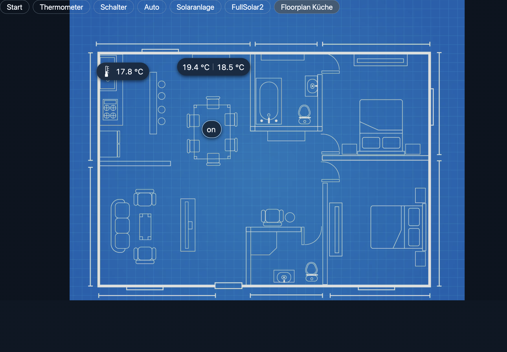
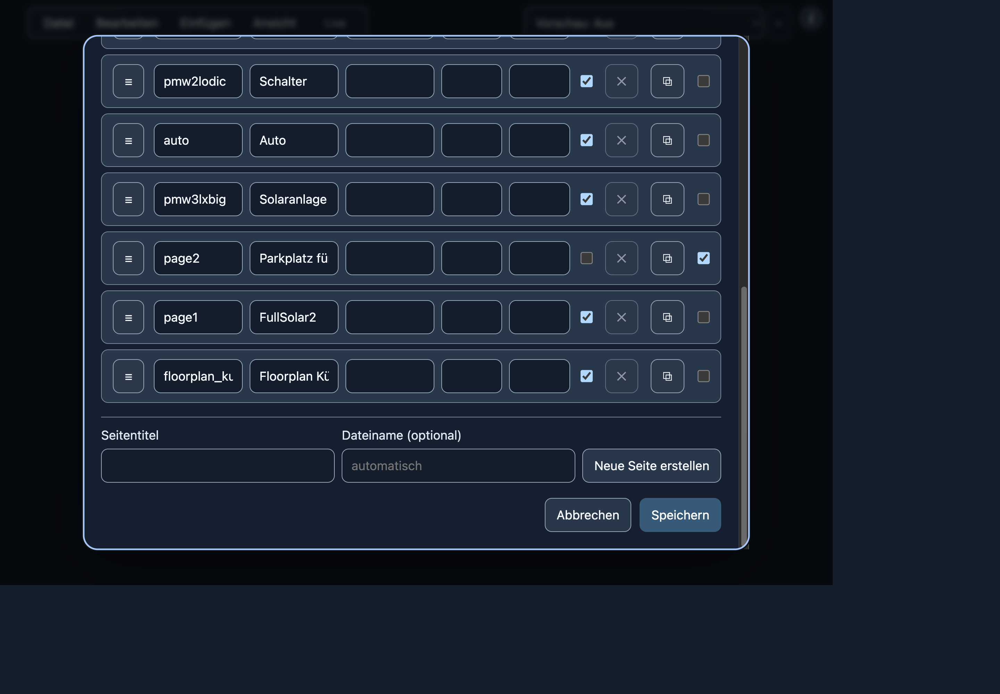
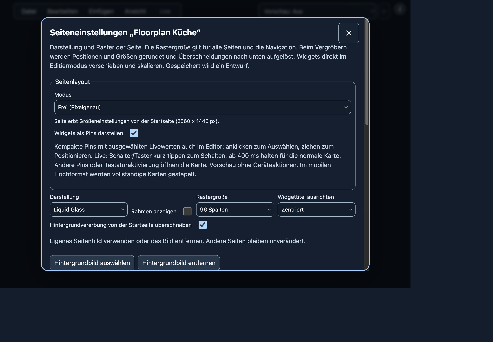
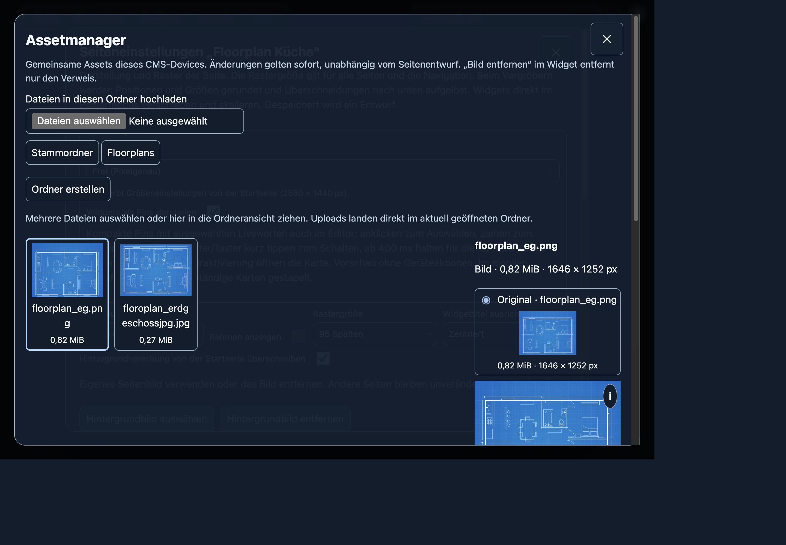
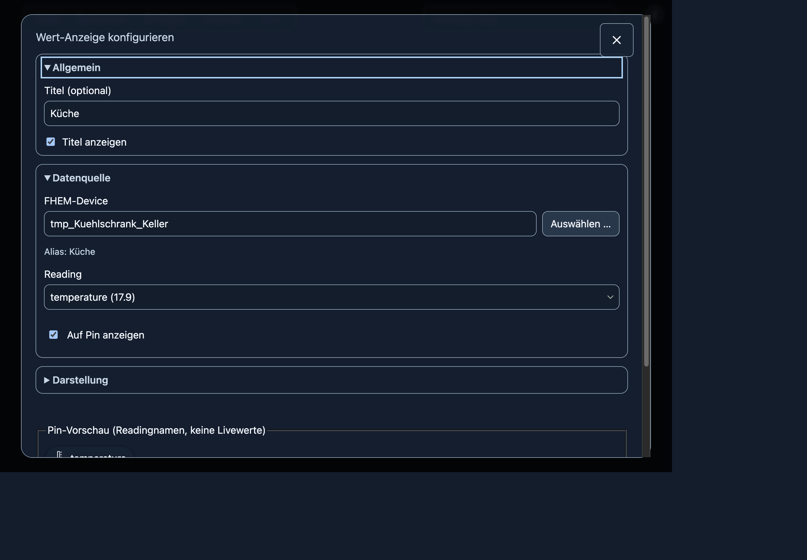
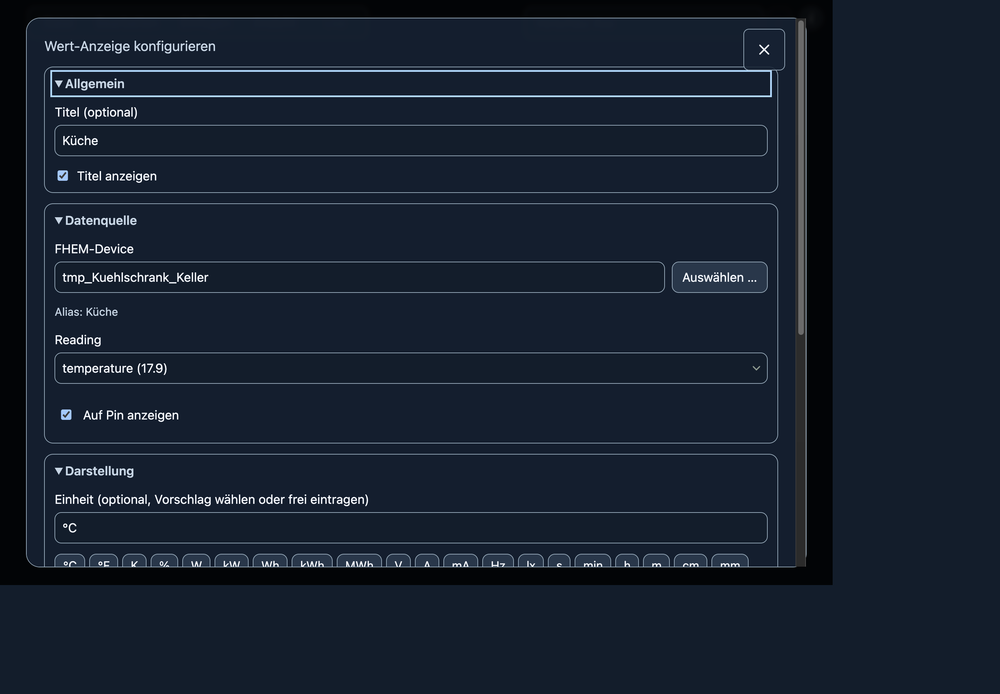
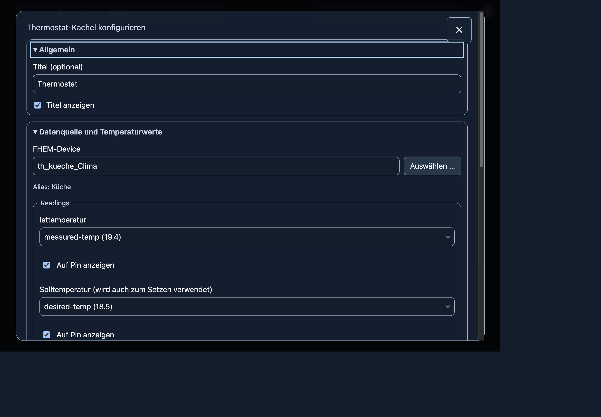
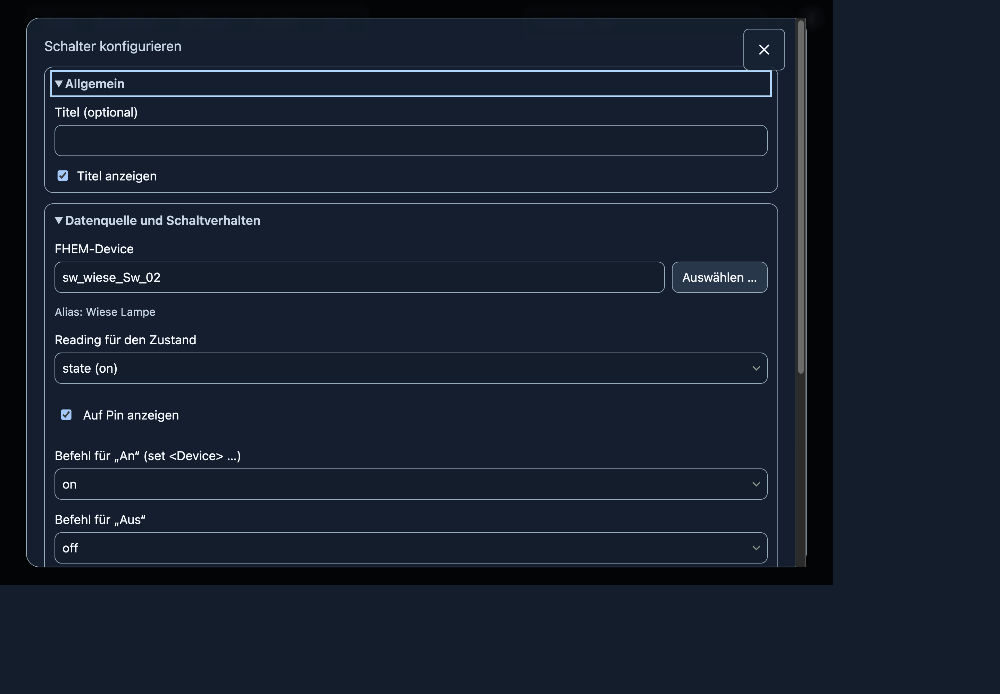
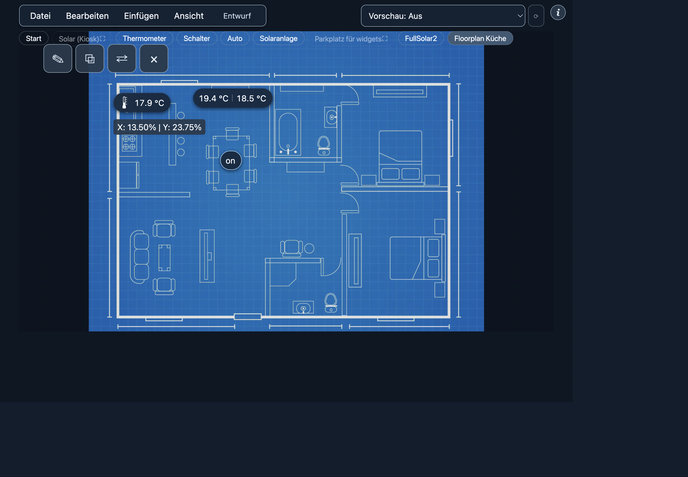
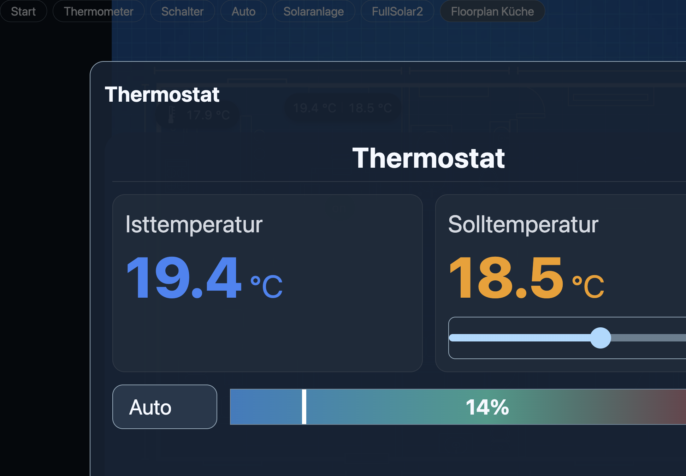

# Floorplan Küche – vom Grundriss zur bedienbaren FHEM-Seite

**Schritt für Schritt: eine eigene Navigationsseite mit Grundriss, Temperatur,
Thermostat und Schalter erstellen – ohne HTML oder eigene JavaScript-Programmierung.**

Diese Anleitung gehört zum Funktionsumfang von **1.14.0**. Die Screenshots
entstanden am 24.11.2026 auf einer echten, für die Dokumentation freigegebenen
FHEM-Instanz mit dem zuvor getesteten Entwicklungsstand 1.30.3-dev.
Messwerte ändern sich laufend; Gerätenamen und Bilder sind Beispiele.

## Das Ergebnis und seine Stärken

Ein normales Dashboard beantwortet „Welcher Wert gehört zu welchem Gerät?“.
Ein Floorplan ergänzt die räumliche Antwort: **Wo im Haus gehört dieser Wert hin?**
Temperatur am Raum, Heizung an der Wand und Schalter bei der Leuchte sind
leichter zuzuordnen als eine lange Liste technischer Gerätenamen.

- **Der Grundriss bleibt sichtbar.** Kompakte Pins zeigen nur die ausgewählten
  Livewerte statt überall große Karten über den Plan zu legen.
- **Ein Gerät, zwei Ansichten.** Hinter dem Pin bleibt das vollständige normale
  Widget verfügbar. Für Details und Bedienung ist kein zweites Widget nötig.
- **Mehrere Werte auf einem Pin.** Beim Thermostat stehen Ist- und Solltemperatur
  nebeneinander; die Ventilstellung bleibt in der Detailkarte.
- **Bildbezogene Positionen.** Die Position wird in Prozent der sichtbaren
  Bildfläche gespeichert, nicht als fester Bildschirmpixel. Ein anders breiter
  Bildschirm verschiebt den Pin deshalb nicht in einen anderen Raum.
- **Bedienbar auf Tablet und Rechner.** Die Pin-Trefffläche bleibt mindestens
  48 × 48 CSS-Pixel groß, auch wenn der Canvas verkleinert wird.
- **Kein Alles-oder-nichts-Layout.** Einzelne Widgets dürfen normale Karten
  bleiben. Andere Seiten können weiterhin Raster oder Freeform ohne Pins nutzen.
- **Passend zum restlichen CMS.** Themefarben, konfigurierte Icons und
  einheitliche Schließen-X gelten auch für die Detailfenster.
- **Sicher vorbereiten.** Bearbeiten erfolgt im Entwurf. Die Pin-Bedienung im
  Editor und in der Geräte-Vorschau sendet keine Schaltbefehle.

> Der Floorplan ist eine Darstellungsart von fhem-cms, kein zusätzlich zu
> installierendes FHEM-Modul. Die Geräte, Readings und Berechtigungen bleiben FHEM.

## 1. Voraussetzungen und Beispiel vorbereiten

Benötigt werden ein eingerichtetes CMS-Device, Bearbeitungszugriff und ein
geeignetes Grundrissbild. Für das Beispiel liegt das Bild bereits im
Assetmanager: **Stammordner → Floorplans → floorplan_eg.png**.
Der tatsächliche Ordnername lautet hier „Floorplans“, nicht „Floorplan“.
Das Bild hat 1646 × 1252 Pixel. Eigene Pläne und eigene Geräte sind möglich.

Wir bauen eine **neue** Seite auf. Eine bereits vorhandene Beispielseite und
ihre Widgets bleiben erhalten; die drei Geräte werden auf der neuen Seite
erneut als Widgets eingebunden.

| Aufgabe | Widget | Beispielgerät | Wichtige Readings |
|---|---|---|---|
| Einzelne Temperatur | Wert-Anzeige | `tmp_Kuehlschrank_Keller` (Alias „Küche“) | `temperature` |
| Ist- und Solltemperatur | Thermostat | `th_kueche_Clima` | `measured-temp`, `desired-temp` |
| Leuchte schalten | Schalter | `sw_wiese_Sw_02` | `state`, Befehle `on` und `off` |

Die technischen Namen sind keine Einrichtungsvorgabe: Bei eigenen Geräten die
tatsächlich vorhandenen Readings und angebotenen Befehle verwenden. Der
Schalter dient hier zur Funktionsdemonstration; seine Position im Plan ist
keine Aussage über den tatsächlichen Einbauort des Beispielgeräts.

Vor größeren Änderungen ist eine Sicherung sinnvoll. Die spätere
Veröffentlichung übernimmt **den gesamten aktuellen CMS-Entwurf**, nicht nur
die gerade geöffnete Seite. Andere vorbereitete Änderungen vorher mitprüfen.

## 2. Die Navigationsseite „Floorplan Küche“ anlegen

1. Das CMS im **Bearbeitungsmodus** öffnen.
2. Die Navigation auswählen und **Navigation einstellen** (Stift) öffnen.
   Alternativ die Navigations-Verschiebefläche per Tab fokussieren und mit
   Enter auswählen; anschließend zum Stift wechseln.
3. Im Dialog **Navigation bearbeiten** zum Bereich für neue Seiten scrollen.
4. Bei **Seitentitel** `Floorplan Küche` eintragen.
5. Bei **Dateiname (optional)** `floorplan_kueche` eintragen.
   Dieser Name wird zum Seitenfragment `#/floorplan_kueche`; kein `.html`
   anhängen.
6. **Neue Seite erstellen** wählen, danach den Dialog mit **Speichern**
   abschließen.
7. Den neuen Navigationspunkt **Floorplan Küche** öffnen.

Der Screenshot zeigt den anschließend gespeicherten neuen Navigationseintrag.
Seitentitel und Navigationsbeschriftung dürfen voneinander abweichen; hier
verwenden wir den Seitentitel auch als Beschriftung.

## 3. Freeform und Pin-Modus einschalten

1. Auf der neuen Seite **Bearbeiten → Seiteneinstellungen „Floorplan Küche“**
   öffnen.
2. Unter **Seitenlayout → Modus** **Frei (Pixelgenau)** wählen.
3. **Widgets als Pins darstellen** aktivieren.
4. Für dieses Beispiel **Liquid Glass** beibehalten.
5. Die vorhandene gemeinsame Seitengröße unverändert lassen.

Im Beispiel erbt die Seite 2560 × 1440 Pixel von der Startseite. Diese
Arbeitsfläche muss **nicht** die Pixelmaße des Bildes haben. Der Grundriss wird
seitenverhältnisgetreu eingepasst; freie Ränder sind möglich. Die Pins beziehen
sich bei vorhandenem Bild auf die wirklich sichtbare Bildfläche.

Die Rastergröße muss für Pins nicht verändert werden. Sie betrifft auch
andere Rasterseiten und die Navigation; für diese Anleitung bleibt sie deshalb
unverändert.

## 4. Eigenen Grundriss aus dem Assetmanager wählen

1. In denselben Seiteneinstellungen **Hintergrundvererbung von der Startseite
   überschreiben** aktivieren.
2. **Hintergrundbild auswählen** öffnen.
3. Im Assetmanager den Ordner **Floorplans** öffnen.
4. **floorplan_eg.png** anklicken. Die rechte Seite zeigt Vorschau, Dateityp,
   Größe und Bildabmessungen.
5. Das **Original** wählen und unten mit **Auswählen** bestätigen.
   Bei einem kleineren Bildschirm gegebenenfalls im Dialog scrollen.
6. Prüfen, dass die Seiteneinstellungen jetzt
   **Stammordner / Floorplans / floorplan_eg.png** anzeigen.
7. **Hintergrund-Abdunklung** im Beispiel auf **12 %** stellen.
8. Die Einstellungen mit **Speichern** im Entwurf sichern.

**Warum die Ausnahme wichtig ist:** Die übrigen Seiten dürfen weiterhin das
gemeinsame Bild der Startseite verwenden. Nur diese Floorplan-Seite erhält den
eigenen Grundriss. Ohne die Ausnahme kann bei eingeschalteter globaler
Hintergrundvererbung das Startseitenbild statt des lokalen Bildes wirksam sein.

Die Abdunklung reicht von 0 bis 50 %. Sie verbessert bei hellen oder
detailreichen Plänen den Kontrast der Pins, verändert aber nicht die Bilddatei.
Ein vorhandenes Bild nur **auswählen**, nicht erneut hochladen oder bearbeiten.
Assetmanager-Änderungen an Dateien gelten unabhängig vom Seitenentwurf sofort.

## 5. Ersten Pin erstellen: Temperatur mit °C

1. **Einfügen → Widget hinzufügen → Wert-Anzeige** wählen.
2. Unter **Allgemein** als Titel `Küche` eintragen.
3. Unter **Datenquelle → FHEM-Device → Auswählen …** den Gerätesucher öffnen.
4. Nach `tmp_Kuehlschrank_Keller` suchen und den Treffer mit Alias „Küche“
   wählen. Bei eigenen Geräten das eigene Temperaturgerät auswählen.
5. Als **Reading** `temperature` auswählen.
6. **Auf Pin anzeigen** unmittelbar beim Reading aktiviert lassen.

7. Den Abschnitt **Darstellung** aufklappen.
8. Als **Einheit** `°C` eintragen oder den entsprechenden Vorschlag wählen.
9. Optional **Icon wählen …** öffnen, nach `temp_temperature` suchen und das
   Thermometer-Icon auswählen.
10. **Nicht als Pin darstellen (normale Kachel behalten)** ausgeschaltet lassen.
11. **Speichern** wählen.

**Erwartetes Ergebnis:** Ein neuer Pin mit Thermometer-Icon und aktuellem
Temperaturwert einschließlich `°C` erscheint zunächst in der Bildmitte.
Die Darstellung ohne ausgewähltes Icon ist ebenfalls erlaubt: Dann erscheint
nur der Wert, **kein** `#`, Dreistrich oder anderes Ersatzsymbol.

Ein Reading namens `temperature` legt keine Einheit fest. Ein fehlendes `°C`
wird deshalb im Widget korrigiert, nicht durch Raten des CMS. Fehlende Messwerte
erscheinen als „–“ ohne Einheit; ein echter Wert `0` bleibt sichtbar.

## 6. Zweiten Pin erstellen: Thermostat mit zwei Temperaturen

1. **Einfügen → Widget hinzufügen → Thermostat** öffnen.
2. Als Titel `Thermostat` eintragen.
3. Das Gerät `th_kueche_Clima` auswählen; nicht den ähnlich benannten
   `ClimaTeam`- oder `Climate`-Kanal.
4. Die Readings passend zum Gerät zuordnen:

   | Feld | Beispiel-Reading | Auf Pin anzeigen |
   |---|---|---|
   | Isttemperatur | `measured-temp` | Ja |
   | Solltemperatur | `desired-temp` | Ja |
   | Ventilstellung | `ValvePosition` | Nein |
   | Betriebsart | `controlMode` | Nein |

5. Beim Feld **Solltemperatur (wird auch zum Setzen verwendet)** zusätzlich
   **Auf Pin anzeigen** aktivieren. Die Isttemperatur ist standardmäßig aktiv.
6. Das Widget als Pin belassen und **Speichern**.

**Erwartetes Ergebnis:** Ist- und Solltemperatur stehen, durch einen feinen
Strich getrennt, auf demselben Pin. Die vollständige Thermostatkarte enthält
weiterhin die weiteren konfigurierten Informationen und Bedienelemente.

Die kleine **Pin-Vorschau** im Konfigurationsdialog zeigt absichtlich
**Readingnamen, keine Livewerte**. Die eigentliche Seite und die
Geräte-Vorschau zeigen die Messwerte. Beim Thermostat gehört die
Celsiusdarstellung zum Temperaturfeld; bei der allgemeinen Wert-Anzeige wird
die Einheit wie in Schritt 5 selbst festgelegt.

## 7. Dritten Pin erstellen: Schalter mit Zustandsanzeige

1. **Einfügen → Widget hinzufügen → Schalter** wählen.
2. Das Beispielgerät `sw_wiese_Sw_02` auswählen.
3. Als **Reading für den Zustand** `state` festlegen.
4. Direkt darunter **Auf Pin anzeigen** aktivieren.
5. **Befehl für „An“** auf `on`, **Befehl für „Aus“** auf `off` setzen.
   Bei eigenen Geräten ausschließlich passende angebotene Befehle verwenden.
6. **Nicht als Pin darstellen** ausgeschaltet lassen und **Speichern**.

Der Pin zeigt nun den bestätigten Zustand `on` bzw. `off`. Wird die
Readinganzeige abgewählt und kein Icon eingerichtet, bleibt ein kompakter
Kreis ohne Ersatzzeichen; für eine gut verständliche Oberfläche deshalb
mindestens einen aussagekräftigen Wert oder ein passendes Icon auswählen.

**Wichtig:** Das Hinzufügen und Konfigurieren schaltet das Gerät nicht.
In der Liveansicht löst kurzes Tippen später einen echten Gerätebefehl aus.
Für die Dokumentationsaufnahme wurden keine Geräte geschaltet und keine
Thermostat-Sollwerte verändert.

## 8. Die drei Pins auf dem Plan platzieren

Neue Pins beginnen bei **50 % / 50 %**. Mehrere nacheinander hinzugefügte
Widgets können deshalb zunächst übereinanderliegen.

1. Den oben liegenden Pin im Editor auswählen.
2. Per Maus oder Touch an die gewünschte Stelle ziehen und loslassen.
3. Die eingeblendete X/Y-Anzeige zur Orientierung verwenden.
4. Die übrigen Pins ebenfalls verteilen.
5. Für Feinjustierung die Pin-Verschiebefläche per Tab fokussieren:
   **Pfeiltasten** bewegen um einen Canvaspixel, **Shift + Pfeil** um zehn.
6. **Escape** während des Ziehens verwirft die laufende Bewegung.

Die Aufnahme verwendet dieselben ungefähren Positionen wie die Vorbildseite:

| Pin | X relativ zum Bild | Y relativ zum Bild |
|---|---:|---:|
| Küche | 13,50 % | 23,75 % |
| Thermostat | 36,47 % | 22,26 % |
| Schalter | 36,00 % | 43,00 % |

Die Werte sind eine Orientierung für **diesen** Plan, keine vorgeschriebenen
Eingaben. In der Praxis den Sensor oder Aktor am tatsächlichen Raum bzw.
Einbauort platzieren. Die Werkzeugleiste erscheint erst nach Auswahl, bleibt
bedienbar groß und schwebt außerhalb des Pins. Der Stift öffnet den gewohnten
Widgetdialog; Kopieren und Seitenwechsel bleiben verfügbar.

Die Position folgt der Bildfläche, nicht den seitlichen Leerbalken. Wird der
Plan proportional eingepasst, bleiben die Pins am zugeordneten Bildpunkt.
Ein späterer Austausch gegen einen anders zugeschnittenen oder inhaltlich
veränderten Grundriss erfordert trotzdem eine Prüfung der Positionen.

## 9. Vorschau prüfen und bewusst veröffentlichen

1. Die Seite mit drei getrennten Pins kontrollieren.
2. In der **Geräte-Vorschau** verschiedene Bildschirmgrößen prüfen.
   Die Vorschau ist für Pin-Geräteaktionen gesperrt.
3. Prüfen: richtige Einheit, richtige Ist-/Sollwerte, eindeutige Anordnung und
   genügend Abstand zwischen den Pins.
4. Andere Änderungen im aktuellen CMS-Entwurf ebenfalls prüfen.
5. **Datei → Entwurf veröffentlichen** wählen und die Rückfrage bestätigen.
   Der vorherige Live-Stand wird gesichert.
6. Die Seite in einem **separaten Browserfenster oder Tab ohne `mode=edit`**
   öffnen. Die Beispieladresse endet auf `index.html#/floorplan_kueche`.
   Unter den Seiteneinstellungen lässt sich die **Direkte Live-URL dieser
   Seite** kopieren.
7. Nach erneutem Laden kontrollieren, dass die neue Navigation und alle drei
   Widgets auch außerhalb des Editors vorhanden sind.

Das Speichern eines einzelnen Dialogs erstellt nur den Entwurf. Erst
**Entwurf veröffentlichen** übernimmt die Konfiguration in die Liveansicht.
Ausgeblendete Navigation oder eine Kioskseite ist kein Zugriffsschutz.

## 10. Die fertige Seite bedienen

| Aktion in der Liveansicht | Wirkung |
|---|---|
| Temperatur-Pin antippen | Normale Wertkarte öffnen |
| Thermostat-Pin antippen | Vollständigen Thermostat im Popup öffnen |
| Schalter/Taster kürzer als 400 ms tippen | Konfigurierten Gerätebefehl senden |
| Schalter/Taster mindestens 400 ms halten | Normale Widgetkarte öffnen, ohne zusätzlichen Pin-Schaltbefehl |
| Mit Tastatur oder Screenreader aktivieren | Normale Karte öffnen, unabhängig von Haltezeiten |
| X oben rechts oder Escape | Popup schließen |

Die Stärke liegt in der Kombination: **Auf dem Grundriss nur das Wesentliche,
im Popup die vertraute vollständige Bedienung.** Nicht jedes Detail muss
dauerhaft einen Teil des Plans verdecken.

Eine Bewegung von mehr als sechs sichtbaren Pixeln bricht eine laufende
Pin-Tippgeste ab. Bei unbekanntem Schalterzustand oder veralteten Daten öffnet
sich stattdessen die Karte; das CMS rät keinen Gegenbefehl. Veraltete Daten
werden am Pin kenntlich gemacht. Ein Sendefehler wird sichtbar gemeldet.

**Achtung:** Im Live-Popup sind die normalen Gerätebedienelemente wirksam.
Die sichere Pin-Vorschau ist kein genereller Schutz vor späteren bewussten
Geräteaktionen in einer echten Livekarte.

## Mobil, gemischte Seiten und Grenzen

- **Tablet/Querformat:** Der Grundriss mit den zugeordneten Pins nutzt den
  verfügbaren Raum; die Bedienflächen bleiben unabhängig vom Canvasmaßstab groß.
- **Mobiles Hochformat:** Statt eines winzigen Plans mit gedrängten Pins werden
  die normalen vollständigen Widgetkarten untereinander dargestellt. Der
  Inhalt bleibt bedienbar, ohne einen zweiten Gerätesatz einzurichten.
- **Normale Karten auf einer Pin-Seite:** Im jeweiligen Widgetdialog
  **Nicht als Pin darstellen (normale Kachel behalten)** aktivieren.
  Uhr, Text und LinkWidget bleiben standardmäßig normale Karten.
- **Keine automatische Raumerkennung:** Geräteauswahl und Platzierung erfolgen
  bewusst durch den Anwender. Der Bildinhalt wird nicht analysiert.
- **Keine geratenen Daten:** Wetter, Diagramm oder andere Widgets ohne feste
  einzelne Pin-Readingquelle liefern nicht automatisch irgendeinen internen
  Wert. Ihre Inhalte bleiben in der normalen Karte verfügbar.
- **Kein neuer Zugriffsschutz:** Es gelten weiterhin FHEMWEB-Zugang,
  Geräteberechtigungen und die Sicherheitsregeln der jeweiligen Installation.

## Häufige Fragen

| Beobachtung | Prüfen / Lösung |
|---|---|
| Pin-Option fehlt | Die Seite zuerst auf **Frei (Pixelgenau)** umstellen. |
| Falsches Hintergrundbild | Auf dieser Seite die Hintergrundvererbung überschreiben und den lokalen Grundriss auswählen. |
| Nur ein Kreis oder kein Messwert | **Auf Pin anzeigen** am passenden Reading einschalten und ein tatsächlich vorhandenes Reading wählen. |
| Kein `°C` an der Wert-Anzeige | Unter **Darstellung → Einheit** `°C` eintragen. |
| Kein Icon sichtbar | Im Widget ein Icon wählen. Ohne konfiguriertes Icon gibt es absichtlich kein Ersatzsymbol. |
| Zweiter Thermostatwert fehlt | **Auf Pin anzeigen** auch am Solltemperatur-Reading aktivieren. |
| Neue Pins verdecken einander | Sie starten alle in der Mitte; nacheinander wegziehen. |
| Pin lässt sich im Editor nicht schalten | Beabsichtigt: Editor und Geräte-Vorschau senden keine Pin-Schaltbefehle. |
| Neues Layout fehlt im anderen Browser | Entwurf veröffentlichen und die Seite ohne `mode=edit` erneut laden. |
| Meldung „Zustand ist veraltet“ | Neu laden, aktuellen Stand prüfen und den Schritt erneut ausführen; keine konkurrierende Änderung überschreiben. |

## Weiterführend

- [Seiten und Navigation](https://github.com/stapetz/fhem-cms/wiki/Seiten-und-Navigation)
- [Assetmanager](https://github.com/stapetz/fhem-cms/wiki/Assetmanager)
- [Layout und mobile Ansicht](https://github.com/stapetz/fhem-cms/wiki/Layout-und-mobile-Ansicht)
- [Thermostat und Steuerung](https://github.com/stapetz/fhem-cms/wiki/Thermostat-und-Steuerung)
- [Editor und Veröffentlichen](https://github.com/stapetz/fhem-cms/wiki/Editor-und-Veroeffentlichen)
